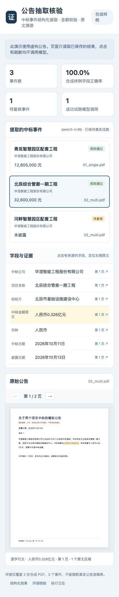

# 中标公告结构化抽取：轻量试跑原型

面向比赛方向 1 的一个小切口：把**电子版中标公告 PDF** 抽取成结构化字段，并让每个字段都能**逐字回溯到原文的页码与坐标**，最后用规则做单位换算、缺失识别和预算串用拦截。

核心主张是**可追溯**而不是"抽得多"：任何一个金额或日期，要么带着原文引文和坐标，要么明确标记为 `null`／待复核，不允许猜、不允许填零。

已实际跑通 **pdfplumber → LangExtract → 本机 Qwen → 规则校验 → JSON/CSV/SQLite → PDF 原文高亮**。

> 本仓库是**试跑原型**，不是可直接提交的完整参赛作品。当前结果只说明小型合成样例流程跑通，**不能推断真实公告准确率或模型稳定性**。

## 演示预览

界面读取已保存的抽取结果与 PDF，点击项目再点击字段即可跳到原 PDF 页码并高亮证据。页面加载、切换、刷新均**只读**保存的 JSON 和 PDF，不运行大模型。



## 已验证的结果

| 合成项目 | 原文中标金额 | 标准金额 | 处理结果 |
|---|---|---|---|
| 青岚智慧园区配套工程 | 人民币1,280.50万元 | 12,805,000 元 | 规则通过，没有误用1,500万元预算 |
| 北辰综合管廊一期工程 | 人民币0.326亿元 | 32,600,000 元 | 规则通过，没有误用4,000万元预算 |
| 河畔智慧园区配套工程 | 尚未确定 | `null` | 待复核，没有填零或误用2,000万元预算 |

两份 PDF、三项事件的 21 个标注字段均匹配，其中 19 个非空字段均有逐字引文、页码与坐标。

本次只进行了 **2 次模型调用**：首次原生 Thinking 调用约 71 秒后达到上限，未生成有效 JSON；第二次使用文本模板预填充，完整流程约 **22 秒**。两次调用均有 token/时间上限，不自动重试，结束后模型卸载。未新增模型、未训练模型、未运行大型多智能体项目。

## 快速开始

需要 Python 3.12（开发环境为 3.12.14）。第三方源码已随仓库提供在 `references/`，依赖以 editable 方式指向该目录，因此**换机后无需另外去 GitHub 克隆参考项目**。

```bash
python3.12 -m venv .venv
.venv/bin/python -m pip install -r requirements.lock.txt
npm ci --prefix prototype/web
```

### 无模型回放（默认）

不调用模型，仅按保存的录制结果重跑校验与评测：

```bash
.venv/bin/python prototype/run_demo.py
```

读取真实试跑保存的 `outputs/extractions.jsonl`，核验输入 PDF、解析文本和录制提取结果的 SHA256，再执行校验与评测。结果写到 `outputs/replay/`，不会覆盖真实推理日志；本次实测校验处理约 0.03 秒，**模型调用为 0**。这验证的是同一份响应的确定性处理，不能视为重新推理得到相同答案。

```bash
.venv/bin/python prototype/verify_demo.py
```

验证回放一致、证据原文及坐标、缺失/预算/区间拒绝处理、录制结果篡改拒绝、同文本不同 PDF 文件哈希拒绝。结果写入 `outputs/verification.json`，不调用模型。

### 查看演示界面

```bash
.venv/bin/python -m http.server 8765 --bind 127.0.0.1
```

然后打开 <http://127.0.0.1:8765/prototype/web/index.html>，终端按 Ctrl+C 停止服务。只想查看数据也可直接打开 `outputs/result.json` 和 `outputs/metrics.json`。

### 日后明确需要时再做真实推理

```bash
.venv/bin/python prototype/run_demo.py --mode live --output outputs/new-live-run
```

每次显式 live 运行最多 **1 次**请求、55 秒请求超时、1,000 输出 token，单次输入最多两份电子 PDF、5,000 字符。已有日志的目录拒绝覆盖。不自动下载模型。当前适配绑定本机 Qwen3-VL Thinking 标签，完整实际提示和参数保存到 `model_request.json`。原文缺少文本层会明确报错，需要另加 OCR。

默认两个合成样例的期望标签只在模型提取完成后读取，参与离线评测，不传给模型。`bidder` 是本原型内部的历史字段名，界面与提示词均明确其含义为 **招标方**。

## 文件布局

| 路径 | 内容 |
|---|---|
| `prototype/` | 编排、样例生成、校验、评测、验证脚本；`web/` 为演示界面 |
| `samples/` | 明确标注虚构的两份 PDF 及 `expected.json` |
| `outputs/` | 成功试跑的结构化结果、CSV、SQLite、原始请求/响应、字符坐标、评测、调用日志 |
| `outputs/attempt01/` | 首次失败试跑的真实请求、响应和失败日志 |
| `outputs/replay/` | 不调用模型的回放结果 |
| `references/` | LangExtract、pdfplumber、PDF.js、PaddleNLP 参考源码（固定 commit，见 `THIRD_PARTY.md`） |
| `THIRD_PARTY.md` | 来源、固定 commit、版本、许可证和使用范围 |

保存的样例 PDF 已包含字体，不需要重新生成；重新生成可执行 `prototype/make_samples.py`。

## 适合作为参赛起点的部分

先做电子版中标公告的字段提取与可追溯核验，把事件组织、单位规则、缺失处理、评测及日志做扎实。PaddleNLP 只借鉴事件/角色组织，没有训练其原模型。下一步应使用少量真实公告和人工标签评测，再决定是否加入 OCR 或研报数字核查。

## 已知局限

- 两份 PDF、三项事件全部为**合成样例**，不能代表真实公告分布。
- 每页只有一个项目，**尚未验证**同页多事件的角色关联。
- 未覆盖扫描件、复杂表格和真实财务材料；原文无文本层会直接报错，需要另加 OCR。
- 模型稳定性未评估：仅成功录制 1 次真实推理，回放验证的是同一份响应的确定性处理。

## 第三方来源

`references/` 下的第三方源码按 `THIRD_PARTY.md` 记录的固定 commit 原样收录，**核心库文件未修改**；自编代码为 `prototype/` 内的样例生成、编排、校验、评测、持久化和演示界面。**不要将第三方源码申报为自研。** 各项目的许可证以其目录内的 `LICENSE`／`LICENSE.txt` 为准（Apache-2.0 或 MIT）。

`references/` 内的 `.git` 目录未纳入本仓库，因此它们在本仓库中是普通文件而非 submodule，不能再直接 `git pull` 更新；需要更新时请按 `THIRD_PARTY.md` 的 commit 重新克隆。`prototype/web/node_modules/`、`work/npm-cache/`、`work/verification/` 为本地构建与中间产物，已通过 `.gitignore` 排除。

本仓库目前**未附带开源许可证**：除 `references/` 中各自保留许可证的第三方代码外，其余代码的版权归作者所有，转载或再分发前请先联系作者。

## 参与与反馈

欢迎提交 Issue 或 Pull Request。由于本仓库未附开源许可证，提交 PR 即表示你同意你的贡献可由本仓库作者在本项目中使用和分发。
